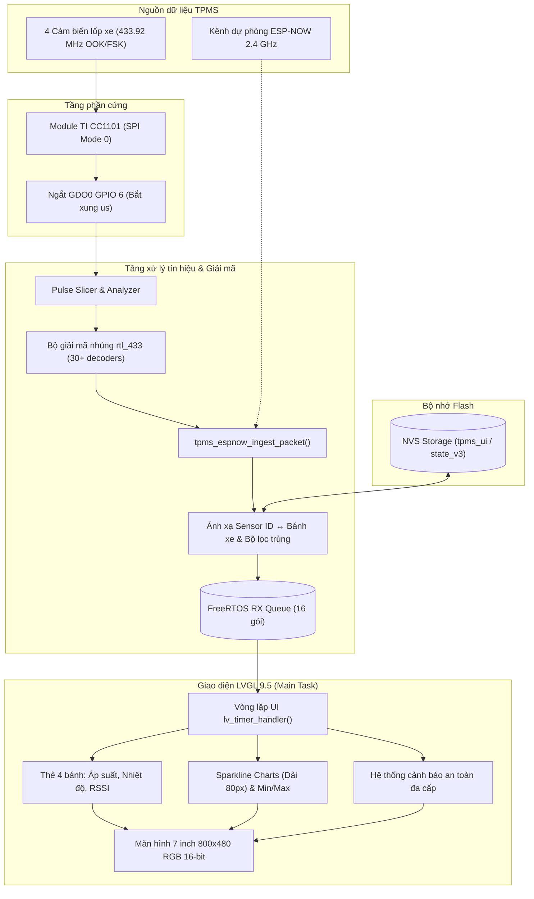

# 🚗 TirePressureScreen (TPMS Automotive Dashboard)

[](https://github.com/espressif/esp-idf)
[](https://platformio.org/)
[](https://lvgl.io/)
[](https://www.waveshare.com/esp32-s3-touch-lcd-7.htm)
[]()
[](https://github.com/merbanan/rtl_433)
[](LICENSE)

Hệ thống giám sát và hiển thị áp suất, nhiệt độ lốp xe (**TPMS - Tire Pressure Monitoring System**) thời gian thực dành cho ô tô, hoạt động độc lập trên màn hình cảm ứng **7 inch Waveshare ESP32-S3-Touch-LCD-7** (độ phân giải **800 × 480**), phát triển bằng **C** với **ESP-IDF v6** và thư viện đồ họa chuyên nghiệp **LVGL v9.5**.

Hệ thống tích hợp trực tiếp module thu sóng RF **Texas Instruments CC1101 (433.92 MHz)** kết hợp với nhân giải mã nhúng **rtl_433** hỗ trợ hơn **30+ dòng xe và cảm biến TPMS** phổ biến, đồng thời hỗ trợ kênh truyền không dây dự phòng **ESP-NOW (2.4 GHz)**.

---

## 📑 Mục lục
1. [Tính năng & Điểm nổi bật](#-tính-năng--điểm-nổi-bật)
2. [Thiết kế giao diện Dashboard (LVGL 9.5)](#-thiết-kế-giao-diện-dashboard-lvgl-95)
3. [Danh sách cảm biến & Hãng xe hỗ trợ](#-danh-sách-cảm-biến--hãng-xe-hỗ-trợ)
4. [Kiến trúc hệ thống](#-kiến-trúc-hệ-thống)
5. [Sơ đồ đấu nối phần cứng & Công tắc SW1](#-sơ-đồ-đấu-nối-phần-cứng--công-tắc-sw1)
6. [Thông số kỹ thuật](#-thông-số-kỹ-thuật)
7. [Hướng dẫn cài đặt, cấu hình & nạp Firmware](#-hướng-dẫn-cài-đặt-cấu-hình--nạp-firmware)
8. [Cấu trúc mã nguồn](#-cấu-trúc-mã-nguồn)
9. [Lộ trình phát triển](#-lộ-trình-phát-triển)

---

## 🌟 Tính năng & Điểm nổi bật

- **Giao diện xe hơi cao cấp (Automotive Dashboard)**:
  - Thiết kế tông màu tối (Dark Mode) chuẩn xe hiện đại, chống chói mắt ban đêm.
  - Trung tâm hiển thị đồ họa xe nhìn từ trên (**Car Top View**).
  - 4 thẻ hiển thị độc lập cho 4 bánh xe: **FL** (Trước trái), **FR** (Trước phải), **RL** (Sau trái), **RR** (Sau phải).
  - Font số áp suất lớn 52pt sắc nét kèm đơn vị đo chuẩn `bar` và `kPa`.
  - Tích hợp biểu đồ mini (**sparkline**) 12 điểm với dải áp suất 1.5 – 3.3 bar, tự động thống kê dải **MIN / MAX** của từng bánh.

- **Hệ thống cảnh báo an toàn đa cấp**:
  - 🔴 **Áp suất thấp (Low Pressure)**: Dưới `2.00 bar` (chữ số và biểu đồ đổi sang màu đỏ cảnh báo).
  - 🟠 **Áp suất cao (High Pressure)**: Trên `2.80 bar` (chữ số và biểu đồ đổi sang màu cam).
  - ⚡ **Tụt áp nhanh / Biến động đột ngột (Rapid Change)**: Chênh lệch $\ge$ `0.20 bar` giữa 2 lần phát liên tiếp (cảnh báo duy trì 30 giây).
  - ⚠️ **Mất tín hiệu cảm biến (Sensor Lost / No Signal)**: Không nhận được gói tin quá `150 giây` (thẻ bánh xe chuyển sang màu xám, hiển thị `--`).
  - Thanh trạng thái trung tâm thông minh: `SYSTEM NORMAL`, `LOW PRESSURE`, `HIGH PRESSURE`, `RAPID CHANGE`, `SENSOR LOST`, `WAITING DATA`, `CHECK TIRES`.

- **Thu sóng vô tuyến trực tiếp 433.92 MHz qua CC1101 & nhúng rtl_433**:
  - Thu nhận trực tiếp tín hiệu OOK/FSK từ các cảm biến van lốp thương mại trên thị trường mà không cần bộ thu rời của nhà sản xuất.
  - Bắt xung micro-giây chính xác cao qua chân ngắt phần cứng **GDO0 (GPIO 6)**.
  - Tích hợp nhân C của thư viện **rtl_433**, giải mã trực tiếp ngay trên ESP32-S3 mà không cần máy tính.

- **Quản lý cảm biến thông minh & Lưu trữ Flash NVS**:
  - Tự động nhận diện (**Auto-bind**) hoặc gán tĩnh mã định danh (**Sensor ID**) cho từng vị trí bánh.
  - Bộ lọc chống trùng lặp thông minh (loại bỏ các gói tin burst lặp lại trong vòng 2.5 giây).
  - Tự động lưu cấu hình và trạng thái vào Flash **NVS**, khôi phục tức thì khi xe khởi động lại.

- **Hỗ trợ kết nối kép (Dual-source)**:
  - Thu trực tiếp qua module CC1101.
  - Hỗ trợ giao thức **ESP-NOW (2.4 GHz)** để nhận dữ liệu từ bộ thu trung gian/relay từ xa nếu không gắn CC1101 trực tiếp lên màn hình.

---

## 🖥 Thiết kế giao diện Dashboard (LVGL 9.5)

Bố cục màn hình 800 × 480 được chia thành 3 khu vực trực quan:

```text
+-----------------------------------------------------------------------------+
|  [ FRONT LEFT - FL ]         [  CENTER CAR PANEL  ]   [ FRONT RIGHT - FR ]  |
|  2.31 bar     Waiting        |                    |   2.29 bar     Waiting  |
|  MIN 2.29   MAX 2.32         |   +------------+   |   MIN 2.28   MAX 2.31   |
|  +------------------------+  |   |   CAR      |   |  +--------------------+ |
|  |  [Sparkline Chart]     |  |   |  TOP VIEW  |   |  |  [Sparkline Chart] | |
|  |  (Chiều cao 80px)      |  |   |   IMAGE    |   |  |  (Chiều cao 80px)  | |
|  +------------------------+  |   +------------+   |  +--------------------+ |
+------------------------------+                    +-------------------------+
|  [ REAR LEFT - RL ]          |                    |   [ REAR RIGHT - RR ]   |
|  2.34 bar     Waiting        |                    |   2.30 bar     Waiting  |
|  MIN 2.32   MAX 2.35         |   SYSTEM NORMAL    |   MIN 2.29   MAX 2.31   |
|  +------------------------+  |  (Status Banner)   |  +--------------------+ |
|  |  [Sparkline Chart]     |  |                    |  |  [Sparkline Chart] | |
|  |  (Chiều cao 80px)      |  |                    |  |  (Chiều cao 80px)  | |
|  +------------------------+  +--------------------+  +--------------------+ |
+-----------------------------------------------------------------------------+
```

> [!TIP]
> Biểu đồ mini ở 4 bánh xe đã được tối ưu tinh gọn: lược bỏ hàng mốc thời gian ở đáy và mở rộng chiều cao lên **80px**, giúp đồ thị hiển thị rõ nét, cân đối với viền bo tròn 18px của thẻ bánh xe.

---

## 🚗 Danh sách cảm biến & Hãng xe hỗ trợ

Firmware nhúng trực tiếp hơn **30+ bộ giải mã rtl_433**, tương thích với cảm biến TPMS nguyên bản (OEM) và cảm biến gắn ngoài phổ biến:

| Hãng xe / Loại cảm biến | Module giải mã trong firmware |
|---|---|
| **Toyota / Lexus** | `tpms_toyota.c`, `tpms_pmv107j.c` |
| **Honda / Acura** | `tpms_honda.c` |
| **Hyundai / Kia** | `tpms_hyundai_vdo.c`, `tpms_kia.c`, `tpms_elantra2012.c` |
| **Ford / Lincoln** | `tpms_ford.c` |
| **Nissan / Infiniti** | `tpms_nissan.c` |
| **BMW / Mini** | `tpms_bmw.c`, `tpms_bmw_g3.c` |
| **Mercedes-Benz** | `tpms_mercedes_benz.c` |
| **Porsche** | `tpms_porsche.c` |
| **Audi / VW / Porsche / VDO** | `schraeder.c`, `tpms_schrader_motorcycle.c` |
| **Renault / Dacia / Citroen** | `tpms_renault.c`, `tpms_renault_0435r.c`, `tpms_citroen.c` |
| **GM / Chevrolet / GMC / Buick** | `tpms_gm.c` |
| **Jeep / Chrysler / Dodge / RAM** | `tpms_jeep.c`, `tpms_abarth124.c` |
| **Cảm biến gắn ngoài phổ thông** | `tpms_jansite.c`, `tpms_jansite_solar.c`, `tpms_jansite_ty468.c`, `tpms_jansite_ty588.c` |
| **Hệ thống xe tải & Aftermarket** | `tpms_truck.c`, `tpms_trw.c`, `tpms_smartire.c`, `tpms_tyreguard400.c`, `tpms_eezrv.c`, `tpms_ave.c`, `tpms_sefis_m3.c`, `tpms_gear_hive.c`, `tpms_airpuxem.c`, `tpms_imars_t240.c` |

---

## 🛠 Kiến trúc hệ thống



---

## 🔌 Sơ đồ đấu nối phần cứng & Công tắc SW1

Màn hình **Waveshare ESP32-S3-Touch-LCD-7** sử dụng phần lớn chân GPIO cho bus RGB LCD 16-bit. Dự án sử dụng giải pháp **ghép kênh chân (pin multiplexing)** thông minh để kết nối CC1101 qua 3 cổng PH2.0 có sẵn:

### Bảng kết nối CC1101 vào cổng PH2.0

| Chân CC1101 | Cổng kết nối trên Waveshare | Chân PH2.0 | GPIO ESP32-S3 | Chức năng |
|---|---|---|---|---|
| **VCC (3.3V)** | **Sensor AD (J8)** | Pin 1 (3V3) | — | Cấp nguồn 3.3V sạch cho module RF |
| **GND** | **Sensor AD (J8)** | Pin 2 (GND) | — | Nối mass chung |
| **GDO0** | **Sensor AD (J8)** | Pin 3 (AD) | **GPIO 6** | Tín hiệu ngắt bắt xung micro-giây |
| **CSN (CS)** | **UART2 (H3)** | Pin 4 (TXD) | **GPIO 43** | Chip Select SPI (Tự nhận diện nếu đảo với RXD) |
| **MISO (SO)** | **UART2 (H3)** | Pin 3 (RXD) | **GPIO 44** | SPI Data Out từ CC1101 |
| **MOSI (SI)** | **I2C (H1)** | Pin 3 (SDA) | **GPIO 8** | Chân chia sẻ với I2C (Bảo vệ bằng mutex) |
| **SCLK (SCK)** | **I2C (H1)** | Pin 4 (SCL) | **GPIO 9** | Chân chia sẻ với I2C (Bảo vệ bằng mutex) |

### ⚠️ Lưu ý cực kỳ quan trọng về công tắc `SW1` & Cổng nạp USB

Bo mạch Waveshare có 2 cổng Type-C và 1 công tắc gạt `SW1`:
- **Cổng "USB" (Khuyên dùng khi nạp)**: Cổng USB native của ESP32-S3 (`USB JTAG/serial debug unit`, ID `303A:1001`). **Cổng này nạp cực nhanh (4.6 giây) và không bị ảnh hưởng bởi công tắc SW1.** Bạn có thể cắm cáp vào cổng này để nạp firmware bất cứ lúc nào mà không cần rút CC1101 hay gạt công tắc.
- **Cổng "UART" (Qua chip nạp CH343)**: Cổng này đi qua công tắc `SW1`:
  - Khi công tắc `SW1` gạt sang **`"UART2"`**: Chân GPIO 43 & 44 được nối tới cổng PH2.0 H3 phục vụ module CC1101. Ở vị trí này cổng "UART" bị ngắt kết nối với chip ESP32-S3.
  - Khi công tắc `SW1` gạt sang **`"UART"` / `"USB"`**: Chân GPIO 43 & 44 nối lại với chip nạp CH343 để nạp firmware. Sau khi nạp xong phải gạt lại về `UART2` để CC1101 hoạt động.

### Cơ chế bảo vệ I2C độc quyền (`cc1101_spi_begin_locked`)
Chân GPIO 8 và 9 được chia sẻ giữa bus I2C (kết nối cảm ứng **GT911** và chip mở rộng **CH422G**) và SPI CC1101. Khi cần truyền dữ liệu với CC1101, hàm sẽ khóa mutex I2C, tạm chuyển ma trận chân GPIO sang Push-Pull (kéo SCLK xuống trước khi hạ CSN để **không bao giờ sinh tín hiệu START/STOP giả trên I2C**), thực hiện giao dịch SPI tốc độ cao và hoàn trả bus I2C nguyên vẹn.

---

## 📊 Thông số kỹ thuật

| Thành phần | Cấu hình & Thông số triển khai |
|---|---|
| **Vi điều khiển** | ESP32-S3 Dual-Core LX7 @ 240 MHz |
| **Bộ nhớ Flash / PSRAM** | 8 MB Flash / 8 MB Octal PSRAM @ 80 MHz |
| **Màn hình LCD** | 7.0 inch RGB 16-bit (ST7262), độ phân giải **800 × 480**, PCLK 16 MHz |
| **Bộ đệm đồ họa (Buffers)** | Framebuffer LCD 768.000 byte trong PSRAM; LVGL buffer 32.000 byte trong SRAM nội |
| **Cảm ứng** | Goodix GT911 điện dung (I2C địa chỉ `0x5D`, INT GPIO 4) |
| **Chip mở rộng I/O** | CH422G (I2C `0x24`): Quản lý Đèn nền, Reset LCD, Reset Touch, SD CS |
| **Tần số thu RF** | **433.92 MHz** (băng tần TPMS quốc tế) |
| **Thời gian mất tín hiệu (Timeout)** | **150 giây** (chuyển sang trạng thái `No Signal` và hiển thị `--`) |
| **Khoảng cách điểm biểu đồ** | Tối thiểu 30 giây / điểm (cập nhật ngay khi có biến động $\ge 0.20$ bar) |
| **Ngưỡng áp suất an toàn** | Thấp: `< 2.00 bar` (200 cbar) \| Cao: `> 2.80 bar` (280 cbar) |
| **Ngưỡng tụt áp đột ngột** | $\Delta \ge$ `0.20 bar` giữa 2 gói tin liên tiếp (cảnh báo 30 giây) |

---

## ⚙️ Hướng dẫn cài đặt, cấu hình & nạp Firmware

### 1. Chuẩn bị môi trường
- Cài đặt **PlatformIO** (qua VS Code Extension hoặc CLI).
- Dây cáp USB Type-C truyền dữ liệu tốt.

### 2. Cấu hình ID cảm biến (Tùy chọn)
Trong file [`include/tpms_espnow.h`](include/tpms_espnow.h), bạn có thể cấu hình mã ID in trên cảm biến của từng bánh:
```c
#define TPMS_SENSOR_ID_FL "2DE995"  // Bánh trước trái
#define TPMS_SENSOR_ID_FR "7EA39A"  // Bánh trước phải
#define TPMS_SENSOR_ID_RL "D2F8BD"  // Bánh sau trái
#define TPMS_SENSOR_ID_RR "D31213"  // Bánh sau phải
```

> [!TIP]
> **Chế độ tự động gán (Auto-bind)**: Nếu để trống `""` (ví dụ `#define TPMS_SENSOR_ID_FL ""`), firmware sẽ tự động gán lần lượt từng cảm biến mới nhận được vào các vị trí bánh còn trống và lưu cố định vào Flash NVS!

### 3. Biên dịch và nạp chương trình

Chạy các lệnh trong thư mục gốc của dự án:

```bash
# 1. Biên dịch firmware
~/.platformio/penv/bin/pio run -e waveshare_lcd_7

# 2. Kiểm tra cổng thiết bị kết nối
~/.platformio/penv/bin/pio device list

# 3. Nạp firmware vào màn hình (khuyên dùng cổng native USB)
~/.platformio/penv/bin/pio run -e waveshare_lcd_7 -t upload --upload-port /dev/ttyACM0

# 4. Mở Serial Monitor xem log giải mã thời gian thực
~/.platformio/penv/bin/pio device monitor -p /dev/ttyACM0 -b 115200
```

*(Nếu lệnh `pio` đã nằm trong `PATH` hệ thống, bạn có thể gọi trực tiếp `pio run...` thay cho đường dẫn đầy đủ).*

---

## 📂 Cấu trúc mã nguồn

```
TirePressureScreen/
├── CMakeLists.txt              # Cấu hình build gốc ESP-IDF CMake
├── platformio.ini              # Cấu hình môi trường biên dịch PlatformIO
├── partitions.csv              # Bảng phân vùng Flash 8MB (Factory App + NVS)
├── sdkconfig.defaults          # Thiết lập Kconfig (PSRAM Octal, Cache 64KB, Heap)
├── include/
│   ├── app_ui.h                # API điều khiển giao diện Dashboard
│   ├── board_display.h         # Khởi tạo LCD ST7262, cảm ứng GT911 & khóa bus I2C
│   ├── tire_data.h             # Hằng số ngưỡng áp suất & kiểu dữ liệu bánh xe
│   ├── tpms_cc1101.h           # Điều khiển phần cứng TI CC1101 & ngắt bắt xung GDO0
│   ├── tpms_espnow.h           # Hàng đợi, bộ lọc trùng, cấu hình ID cảm biến & ESP-NOW
│   └── rtl_433/                # Header giải mã giao thức vô tuyến TPMS
├── src/
│   ├── main.c                  # Điểm khởi chạy app_main, luồng FreeRTOS, lưu Flash NVS
│   ├── board_display.c         # Driver ST7262 RGB LCD, GT911 touch, CH422G expander
│   ├── app_ui.c                # Quản lý giao diện: cập nhật số đo, biểu đồ sparkline, cảnh báo
│   ├── tpms_cc1101.c           # Giao tiếp SPI CC1101, giải điều chế OOK, bắt xung GDO0
│   ├── tpms_espnow.c           # Ánh xạ Sensor ID, chống dồn gói, hàng đợi RX
│   ├── tire_data.c             # Phân loại trạng thái áp suất & dữ liệu mô phỏng demo
│   ├── rtl_433/                # Nhân C thư viện rtl_433 và 30+ bộ giải mã TPMS
│   └── UI/                     # Tài nguyên đồ họa LVGL
│       ├── fonts/              # Custom fonts (font_pressure_52, font_label_18, font_unit_22)
│       ├── images/             # Đồ họa xe nhìn từ trên (Car Top View)
│       └── screens/            # Mã nguồn sinh tự động giao diện dashboard_gen
```

---

## 🧭 Lộ trình phát triển (Roadmap)

- [x] Giao diện Dashboard ô tô 800 × 480 với LVGL 9.5.
- [x] Tinh chỉnh biểu đồ mini 80px sắc nét, loại bỏ thanh mốc thời gian thừa.
- [x] Tích hợp thu trực tiếp CC1101 433.92 MHz & 30+ decoder rtl_433.
- [x] Quản lý Sensor ID & lưu trữ trạng thái vào Flash NVS.
- [x] Hỗ trợ nạp thuận tiện qua cổng Native USB JTAG.
- [ ] Giao diện cảm ứng hỗ trợ đảo lốp xe (**Tire Rotation**) trực tiếp trên màn hình.
- [ ] Menu cài đặt ngưỡng cảnh báo áp suất và đơn vị đo (`bar` / `psi` / `kPa`) qua UI.
- [ ] Tích hợp cảnh báo âm thanh qua còi buzzer hoặc loa I2S (giọng nói tiếng Việt).
- [ ] Mở rộng hỗ trợ cảm biến TPMS chuẩn Bluetooth Low Energy (BLE).

---

## 📄 Bản quyền (License)

Dự án được phân phối theo giấy phép **MIT License**. Phần giải mã vô tuyến sử dụng mã nguồn phái sinh từ dự án mã nguồn mở [rtl_433](https://github.com/merbanan/rtl_433).
