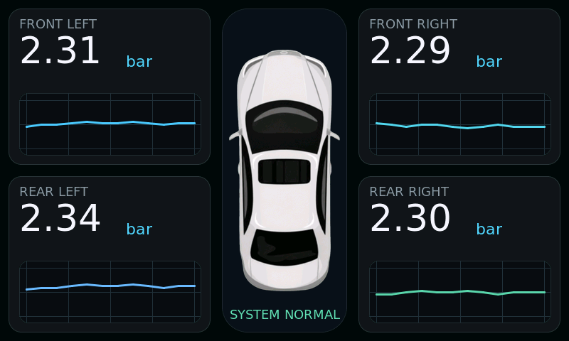

# TirePressureScreen

Giao diện áp suất bốn bánh xe, xuất từ LVGL Pro, dùng LVGL **9.5.0** ở độ phân giải **800 × 480**.

## Trạng thái hiện tại

- Có chương trình chạy UI trên máy tính và xuất ảnh PNG, không cần board, SDL2 hoặc LVGL Pro.
- Có `app_main()` cho ESP-IDF: khởi tạo LVGL, tạo dashboard, cấp tick bằng `esp_timer`, xử lý timer trong một task và ghi log định kỳ.
- Firmware đã tích hợp LCD RGB ST7262, đèn nền/reset CH422G và cảm ứng GT911 cho **Waveshare ESP32-S3-Touch-LCD-7** theo model người dùng cung cấp. Đã build thành công; **chưa nạp/chạy trên thiết bị thật**.
- Áp suất, biểu đồ và chữ `SYSTEM NORMAL` là dữ liệu cố định từ bản export; chưa có đọc cảm biến hay logic cảnh báo.

## 1. Chạy thử trên máy tính Linux

Mở Terminal tại thư mục gốc project (thư mục chứa `platformio.ini`).

### Chuẩn bị

Cần CMake, trình biên dịch C/C++, Make và Python 3:

```bash
sudo apt install build-essential cmake python3
```

Thư viện LVGL được dùng chung với PlatformIO tại `.pio/libdeps/waveshare_lcd_7/lvgl`.
Nếu chưa có thư viện, cài dependency trước:

```bash
~/.platformio/penv/bin/pio pkg install -e waveshare_lcd_7
```

Máy đã có LVGL thì bước chạy trên PC không cần mạng. Trên máy mới, PlatformIO có thể cần tải platform, toolchain và thư viện.

### Build và chạy

```bash
cmake -S tools/ui_preview -B build-host -DCMAKE_BUILD_TYPE=Debug
cmake --build build-host -j4
python3 tools/ui_preview/run.py
```

Lệnh cuối chạy code C của LVGL và UI, sau đó chuyển framebuffer sang PNG bằng thư viện chuẩn Python. Mở `build-host/dashboard.png` trong VS Code để xem kết quả. Đây là bản vẽ thực từ LVGL, không phải ảnh dựng lại bằng HTML hoặc ảnh lấy từ LVGL Pro.

Chương trình chạy xong sẽ tự thoát; **không mở cửa sổ tương tác**. `build-host/dashboard.ppm` là ảnh trung gian.

Chạy kiểm tra tự động:

```bash
ctest --test-dir build-host --output-on-failure
```

Bài kiểm tra chạy tick/timer LVGL trong **2.000 ms thời gian giả lập**, kiểm tra:

- Dashboard tạo được và có bốn nhãn áp suất `2.31`, `2.29`, `2.34`, `2.30`.
- Có gọi hàm xuất vùng ảnh (`flush`) và các vùng vẽ nằm trong kích thước màn hình.
- Framebuffer có nội dung, không phải một màu trống.
- Ghi được ảnh kết quả.

Bài `gt911_reports` kiểm tra giải mã tọa độ hai góc màn hình, thứ tự byte, trạng thái nhấn/nhả/chưa có dữ liệu, gói bị thiếu, số điểm không hợp lệ và tọa độ ngoài màn hình. Dữ liệu GT911 của bài kiểm tra được tạo bằng phần mềm, không đọc từ thiết bị.

Hai bài kiểm tra chưa kiểm chứng logic cập nhật cảm biến, thao tác cảm ứng thật, FPS hoặc thời gian chạy thực trên ESP32. Nếu thay đổi các số mặc định trong thiết kế, cập nhật giá trị mong đợi ở `tools/ui_preview/main.c`.

### Sau khi sửa hoặc xuất lại UI

Chạy lại ba lệnh build/chạy ở trên. Các thư mục build nằm ngoài `src` để không bị đưa vào firmware.

Nếu muốn dùng một bản LVGL 9.5.0 ở vị trí khác:

```bash
cmake -S tools/ui_preview -B build-host -DLVGL_DIR=/duong/dan/toi/lvgl
```

## 2. Build firmware ESP32-S3

```bash
~/.platformio/penv/bin/pio run -e waveshare_lcd_7
```

Hoặc chọn **PlatformIO → Project Tasks → waveshare_lcd_7 → General → Build** trong VS Code. Nếu `pio` đã có trong PATH, có thể dùng `pio` thay cho đường dẫn đầy đủ.

Lệnh trên chỉ build. Khi thành công, firmware nằm tại:

```text
.pio/build/waveshare_lcd_7/firmware.elf
.pio/build/waveshare_lcd_7/firmware.bin
```

### Cấu hình board

| Thành phần | Cấu hình |
|---|---|
| PlatformIO platform | `espressif32@7.0.1` |
| Phần cứng | Waveshare ESP32-S3-Touch-LCD-7, 800 × 480 |
| Board nền PlatformIO | `esp32-s3-devkitc-1`; cấu hình LCD/PSRAM được bổ sung riêng |
| Framework | ESP-IDF; môi trường đã kiểm tra dùng 6.0.1 |
| LVGL | `9.5.0`, RGB565, vẽ bằng CPU |
| Flash cấu hình | 8 MB; dùng được phần flash này trên cả phiên bản N8R8 và N16R8 |
| Phân vùng | Một ứng dụng, nằm trong 2 MB đầu, không OTA/filesystem |
| Stack main task | 8.192 byte |
| Bộ đệm vẽ LVGL | 800 × 20 × 2 = 32.000 byte, cấp phát trong RAM nội |
| Framebuffer LCD | Một buffer RGB565 768.000 byte trong PSRAM |
| Bounce buffer DMA | Hai buffer, mỗi buffer 800 × 10 × 2 = 16.000 byte trong RAM nội |
| PSRAM | Octal 80 MHz; board có 8 MB; kiểm tra và in dung lượng lúc khởi động |
| LCD timing | PCLK 16 MHz, cạnh âm; H/V pulse 4, back porch 8, front porch 8 |
| FreeRTOS tick | 1.000 Hz |
| Serial monitor | 115200 baud |

Waveshare công bố cả phiên bản Flash 8 MB và 16 MB, cùng PSRAM 8 MB. Project chọn Flash 8 MB và phân vùng ứng dụng dưới 2 MB, nên không cần phân biệt hai phiên bản để build bản này. Thông số này dựa trên [tài liệu board](https://docs.waveshare.com/ESP32-S3-Touch-LCD-7), chưa phải kết quả đọc chip thật.

`sdkconfig.defaults` dành cho cấu hình mới; `sdkconfig.waveshare_lcd_7` là cấu hình hiện có. Nếu đổi cấu hình, đồng bộ cả hai. Pinout dưới đây dành riêng cho model `ESP32-S3-Touch-LCD-7`.

| Tín hiệu | Chân |
|---|---|
| RGB D0…D15, theo đúng thứ tự | 14, 38, 18, 17, 10, 39, 0, 45, 48, 47, 21, 1, 2, 42, 41, 40 |
| HSYNC / VSYNC / DE / PCLK | GPIO46 / GPIO3 / GPIO5 / GPIO7 |
| I2C SDA / SCL | GPIO8 / GPIO9, 400 kHz |
| GT911 INT | GPIO4; giữ LOW trong reset để chọn địa chỉ 7-bit `0x5d`, sau đó trả về input |
| CH422G | Địa chỉ lệnh cấu hình `0x24`, ghi trạng thái output `0x38` |
| Reset cảm ứng / đèn nền / reset LCD | CH422G EXIO1 / EXIO2 / EXIO3 |
| SD CS / USB-CAN select | EXIO4 HIGH (không chọn SD), EXIO5 LOW (giữ USB) |

Pin và trình tự được đối chiếu với [code mẫu Waveshare](https://github.com/waveshareteam/ESP32-S3-Touch-LCD-7/tree/bc51a84b30c0cea018fee6e0d7427ec10102060e/examples/ESP-IDF/09_lvgl_v9_demo). Driver của project dùng API ESP-IDF 6.0.1; không dùng API I2C cũ của mẫu.

### Nạp và đọc log trên board

Các lệnh dưới đây **chưa được thực hiện trong lần kiểm tra này**, vì không có board kết nối. Cắm cáp USB có dữ liệu vào board rồi tìm cổng bằng `pio device list`.

```bash
~/.platformio/penv/bin/pio device list
~/.platformio/penv/bin/pio run -e waveshare_lcd_7 -t upload --upload-port /dev/ttyACM0
~/.platformio/penv/bin/pio device monitor -p /dev/ttyACM0 -b 115200
```

Thay `/dev/ttyACM0` bằng cổng thực tế. Nhấn `Ctrl+C` để thoát monitor.

Nếu dùng cổng USB-UART, cổng Linux thường có dạng `/dev/ttyUSB0`; console UART được đặt ở 115200. Cấu hình cũng bật console phụ USB Serial/JTAG. Nếu không tự vào chế độ nạp, giữ BOOT, nhấn rồi thả RESET, thả BOOT và chạy lệnh upload lại.

Các chuỗi log **dự kiến theo code**, không phải log đã thu từ board:

```text
Starting Waveshare ESP32-S3-Touch-LCD-7
PSRAM: ... bytes
GT911 ready at 0x5d (single pointer, polling)
RGB LCD ready: 800x480 RGB565, PCLK 16 MHz
Dashboard loaded: 800x480, LVGL 9.5.0
UI task alive; LCD flushes=...; free internal heap=...
Touch: x=... y=...
```

Log cuối xuất hiện khoảng mỗi 5 giây. Với giao diện tĩnh, số lần flush không bắt buộc tăng liên tục.

Đèn nền bật sau khi LVGL vẽ khung hình đầu tiên. Chạm rồi nhả ở bốn góc để đối chiếu tọa độ với khoảng x=0…799, y=0…479. Driver đọc một con trỏ cho LVGL; chưa hỗ trợ cử chỉ đa điểm. Dashboard hiện chưa có nút/hành động tương tác, nên dùng log tọa độ để kiểm tra cảm ứng.

Nếu GT911 không phản hồi, firmware ghi `Touch disabled: ...` rồi tiếp tục hiển thị LCD. Lỗi khởi tạo PSRAM, I2C expander hoặc LCD sẽ dừng khởi động qua `ESP_ERROR_CHECK` và ghi nguyên nhân vào Serial.

LCD dùng một framebuffer và hai bounce buffer. Lệnh RGB `draw_bitmap` của IDF 6 sao chép đồng bộ buffer LVGL vào framebuffer, sau đó mới báo `lv_display_flush_ready()`. Chưa đồng bộ đổi frame với VSYNC; chưa xác nhận mức tearing khi cập nhật nhanh trên phần cứng. Dashboard hiện có nội dung tĩnh.

## 3. Cấu trúc code

```text
include/lv_conf.h        Cấu hình LVGL dùng chung
include/app_ui.h         Kích thước và API khởi động UI
src/main.c              app_main ESP-IDF, khởi động board, tick/timer và log
src/app_ui.c            Khởi tạo tài nguyên và mở dashboard
src/board_display.c     Driver RGB LCD, CH422G và GT911 qua I2C
src/gt911_report.c      Giải mã tọa độ GT911; dùng chung với bài kiểm tra PC
src/UI/                 Code xuất từ LVGL Pro, font/ảnh dạng C
tools/ui_preview/       Chương trình chạy/vẽ trên PC, CMake và script PNG
partitions.csv          Phân vùng firmware
sdkconfig.defaults      Cấu hình ESP-IDF mặc định
docs/test-results/      Ảnh và log của lần kiểm tra thực tế
```

`src/CMakeLists.txt` đọc danh sách nguồn từ `src/UI/file_list_gen.cmake` và `user_config.cmake`, thay cho quét toàn bộ `src/*.*`.
LVGL được đăng ký một lần dưới dạng component ESP-IDF. `lib_deps` cài thư viện, còn `lib_ignore = lvgl` tránh việc PlatformIO LDF build lại nó như một thư viện độc lập.

Không cần PNG/TTF/XML gốc ở runtime vì ảnh và font hiện được nhúng trong code C.

### Lưu ý khi xuất lại từ LVGL Pro

Giữ cấu trúc `src/UI`, bao gồm các màn hình đang được header và danh sách CMake tham chiếu. Hai điểm tương thích cần lưu ý:

- `include/lv_conf.h` để `LV_USE_XML` không định nghĩa vì header xuất dùng `#ifdef LV_USE_XML`. Bản này chạy code C, không dùng XML runtime.
- Trong `UI_design_gen.c`, khai báo ảnh đã được sửa thành `extern const lv_image_dsc_t car_top_image_data;` để khớp kiểu định nghĩa trong `images/car_top_image_data.c`. Nếu export ghi đè thành `extern const void *`, cần sửa lại. Dữ liệu pixel vốn đã có `static const`; giữ nguyên.

## 4. Kết quả kiểm tra thực tế — 15/09/2026

Môi trường: Linux, PlatformIO Core 6.1.19, Espressif32 7.0.1, ESP-IDF 6.0.1, LVGL 9.5.0.

| Kiểm tra | Kết quả |
|---|---|
| CMake build chương trình PC | PASS |
| CTest `dashboard_render` và `gt911_reports` | PASS, 2/2 |
| Chạy code UI và xuất ảnh | PASS, 800 × 480, 12 flush, 328.145 pixel khác màu nền |
| Bốn nhãn áp suất | PASS: FL 2.31, FR 2.29, RL 2.34, RR 2.30 |
| Kiểm tra ảnh trực quan | Có ảnh xe, đủ bốn biểu đồ, font/số và trạng thái; không thấy cắt/chồng chữ ở ảnh đã xem |
| Build firmware LCD/cảm ứng ESP32-S3 | PASS, tạo được `firmware.elf` và `firmware.bin`, 52,02 giây |
| Chạy firmware trên board/LCD/cảm ứng | Chưa thực hiện; không có cổng `/dev/ttyACM*` hoặc `/dev/ttyUSB*` tại lúc kiểm tra |

Ảnh thực tế:



Build firmware báo RAM tĩnh **17.552 / 327.680 byte (5,4%)** và Flash ứng dụng **827.729 / 2.031.616 byte (40,7%)**. Bộ đệm LCD/LVGL hiện cấp phát ở runtime nên không nằm trong số RAM tĩnh này; mức RAM tĩnh thấp hơn bản kiểm thử trước không đồng nghĩa tổng RAM sử dụng thấp hơn. Chưa đo heap/stack thực trên board.

Không có lỗi biên dịch trong lần build cuối. Còn hai cảnh báo từ code export: biến `buf` và hàm `check_font` không được sử dụng khi chạy C không có XML. Các cảnh báo này được giữ nguyên trong log.

Log: [CTest](docs/test-results/host-test.log), [chạy UI](docs/test-results/host-run.log), [build firmware](docs/test-results/firmware-build.log).

## 5. Xử lý lỗi thường gặp

- **Không tìm thấy LVGL:** chạy `pio pkg install -e waveshare_lcd_7`, hoặc truyền `-DLVGL_DIR` khi cấu hình CMake cho PC.
- **Không có `pio` trong PATH:** dùng `~/.platformio/penv/bin/pio` trên máy này.
- **PlatformIO báo không ghi được `~/.platformio/platforms.lock`:** chạy trong Terminal có quyền ghi thư mục PlatformIO. Lần kiểm tra trong sandbox cần được cấp quyền chạy build ngoài sandbox; không cần chạy `sudo pio`.
- **LCD không hiện sau khi nạp:** kiểm tra log PSRAM, CH422G/I2C và RGB LCD; kiểm tra nguồn/cáp và đúng model board. Các thông báo `PSRAM unavailable` hoặc `Board reset failed` cho biết khởi tạo chưa hoàn tất.
- **LCD hiện nhưng cảm ứng không chạy:** tìm `Touch disabled`/`Touch I2C error` trong log; đối chiếu cáp cảm ứng, địa chỉ `0x5d` và trình tự reset. Chưa có bước hiệu chỉnh xoay/lật tọa độ trong bản này.
- **Ảnh/số không giống bản thiết kế mới:** xuất lại code C vào `src/UI` rồi cấu hình/build lại; công cụ PC không đọc XML của LVGL Pro.

Tham khảo: [LVGL chạy trên PC](https://lvgl.io/docs/open/9.5/integration/pc/index.html), [PlatformIO Build](https://docs.platformio.org/en/latest/core/userguide/cmd_run.html).
