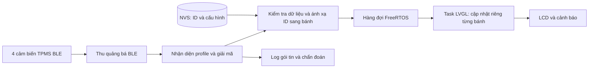

# Thiết kế hệ thống cảm biến TPMS và thu dữ liệu thật

Ngày lập: 07/10/2026. Phạm vi: thiết kế cho dự án TirePressureScreen hiện tại.

**Trạng thái:** người dùng xác nhận chưa có cảm biến, sau đó cung cấp thông số một bộ TPMS ghi `SY36201` / `BLE4.1` / Bluetooth 5.0 để xem xét (mục 11). Chưa chốt model/revision và chưa có gói tin từ phần cứng. Chưa thu được số đo thực tế. Tài liệu này là thiết kế triển khai; firmware hiện vẫn chạy mô phỏng.

## 1. Điểm xuất phát của dự án

| Hạng mục | Hiện trạng đã kiểm tra trong repository |
|---|---|
| Màn hình | Waveshare ESP32-S3-Touch-LCD-7, 800 × 480, ESP-IDF + LVGL |
| Nguồn áp suất | `src/main.c` gọi `tire_simulation_sample()` mỗi 3 giây |
| Mô hình số liệu | `include/tire_data.h`: áp suất kiểu `uint16_t`, đơn vị 0,01 bar |
| Nhận từng bánh | Đã có `app_ui_receive(wheel, pressure)` trong `src/app_ui.c` |
| Luồng giao diện | `include/app_ui.h` yêu cầu gọi API cập nhật trên task LVGL |
| Mất tín hiệu | Timeout 150 giây riêng từng bánh; timer kiểm tra mỗi 250 ms |
| Bluetooth | `sdkconfig.waveshare_lcd_7` hiện chưa bật `CONFIG_BT_ENABLED` |
| Lưu cấu hình | Có phân vùng NVS; chưa có luồng ghép ID cảm biến với vị trí bánh |

Các ngưỡng 2,00 / 2,80 bar, chênh lệch 0,20 bar và timeout 150 giây đang là cấu hình demo. Nhịp phát thật của cảm biến chưa được xác định; không suy ra nhịp này từ chu kỳ mô phỏng.

## 2. Chọn cách thu dữ liệu

**Đề xuất ban đầu:** dùng 4 cảm biến TPMS BLE hoàn chỉnh, có ID riêng và giao thức đọc được, thu trực tiếp trên ESP32-S3. Lựa chọn này tận dụng radio có sẵn và không cần thêm dây tín hiệu vào các GPIO đang phục vụ LCD. ESP32-S3 hỗ trợ Bluetooth LE 2,4 GHz; không có bộ thu TPMS 315/433 MHz tích hợp. [Nguồn: Espressif ESP32-S3](https://www.espressif.com/en/products/socs/esp32-s3).

| Phương án | Điều kiện sử dụng | Quyết định thiết kế |
|---|---|---|
| TPMS BLE → ESP32-S3 | Đã xác minh payload quảng bá hoặc dịch vụ GATT của đúng model | Ưu tiên nếu chưa mua cảm biến |
| TPMS 315/433 MHz → bộ thu giải mã → màn hình | Bộ thu tương thích đúng cảm biến và có tài liệu đầu ra UART/RS485/CAN | Chọn nếu đã có bộ TPMS RF phù hợp |
| Cảm biến nguyên bản → CAN của xe | Có tài liệu hoặc bản ghi đã xác minh ID khung, vị trí byte, đơn vị và điều kiện phát | Chỉ thiết kế tiếp khi biết xe và giao thức |

Theengs công bố một profile TPMS BLE quảng bá không mã hóa, có áp suất, nhiệt độ, pin và báo lỗi. Đây là **một profile tham khảo**, không phải cam kết mọi sản phẩm ghi “TPMS Bluetooth” đều tương thích. [Nguồn: Theengs TPMS](https://decoder.theengs.io/devices/TPMS.html).

Với RF, cùng tần số chưa đủ để tương thích: còn điều chế, framing, mã hóa và checksum. `rtl_433` có các decoder TPMS và hỗ trợ SDR, phù hợp để khảo sát trên máy tính trước khi chọn bộ thu nhúng. Không coi USB SDR là thiết bị có thể cắm vào màn hình và dùng ngay. [Nguồn: rtl_433](https://github.com/merbanan/rtl_433).

## 3. Kiến trúc đề xuất

Các khối giải mã, ánh xạ và giao diện dùng chung cho cả BLE và bộ thu RF; chỉ thay lớp nhận và decoder theo phần cứng. Hệ thống hiển thị tại chỗ không cần Internet hay máy chủ.

**Phần cứng cần có cho phương án BLE:**

- Màn hình Waveshare hiện tại.
- 4 cảm biến TPMS có dải đo, nhiệt độ làm việc, kiểu van và độ chính xác phù hợp với lốp; ưu tiên model có tài liệu payload hoặc đã kiểm chứng bằng gói tin thật.
- Nguồn 5 V ổn định cho màn hình; nguồn trên xe cần bộ chuyển đổi phù hợp. Tài liệu Waveshare ghi đầu vào Type-C 5 V. [Nguồn: Waveshare](https://docs.waveshare.com/ESP32-S3-Touch-LCD-7).
- Dụng cụ đo áp suất đối chứng và điện thoại/máy tính có khả năng ghi quảng bá BLE.

Không tự chốt model, tuổi thọ pin, khoảng cách thu, độ chính xác hoặc chu kỳ phát khi chưa có datasheet và phép đo. Đề xuất dùng cảm biến TPMS hoàn chỉnh; việc tự thiết kế bo cảm biến gắn trên bánh là một hạng mục riêng.

**Lộ trình chọn mua khi chưa có cảm biến:** thử một chiếc hoặc một bộ mẫu trước; chỉ mua đủ bốn vị trí sau khi đọc đúng dữ liệu trên ESP32-S3. Nếu sản phẩm chỉ bán nguyên bộ, yêu cầu tài liệu và bản ghi quảng bá mẫu trước khi chọn. Chưa có căn cứ để chốt mã hàng hoặc báo giá trong note này.

Nội dung cần hỏi người bán:

> Tôi cần cảm biến áp suất lốp đọc trực tiếp bằng ESP32-S3 BLE. Xin cung cấp model/revision, xác nhận dữ liệu đi từ cảm biến qua BLE (không chỉ từ màn hình trung gian sang điện thoại), tài liệu payload quảng bá hoặc UUID GATT, yêu cầu khóa/mã hóa, ID riêng từng cảm biến và một gói hex mẫu kèm áp suất tương ứng. Xin cho biết dải đo, sai số, áp suất tuyệt đối hay tương đối, kiểu van tương thích, loại pin, chu kỳ gửi khi đứng yên/khi chạy và cách đánh thức cảm biến.

Tiêu chí chọn mẫu: giao thức có thể kiểm chứng, ID ổn định, đủ dải đo cho loại xe dự kiến và phù hợp cơ khí với van. Hình thức bên ngoài hoặc việc dùng cùng ứng dụng điện thoại chưa chứng minh hai lô hàng dùng cùng payload. Nếu không lấy được tài liệu/gói mẫu, chuyển sang nhà cung cấp khác hoặc bộ TPMS có bộ thu xuất dữ liệu được mô tả rõ.

**Nếu dùng bộ thu có dây:** xác định đầu ra TTL, RS485 hay CAN trước khi đấu. UART TTL không nối trực tiếp vào cổng RS485 A/B. Chọn chân sau khi kiểm tra sơ đồ đúng phiên bản board và đường Serial đang dùng.

Các ràng buộc trên màn hình: CAN dùng GPIO19/20 chung đường với USB native, chọn bằng EXIO5; hai đầu UART được chuyển bằng công tắc và chia sẻ cùng một UART; I2C GPIO8/9 đang phục vụ touch và IO expander. Firmware hiện giữ EXIO5 LOW để chọn USB và dùng UART0 làm console chính. Không lấy các giao tiếp này làm cổng thu độc lập mà bỏ qua xung đột. [Nguồn phần cứng: Waveshare, mục Interface Description và Onboard Resources](https://docs.waveshare.com/ESP32-S3-Touch-LCD-7); nguồn cấu hình: `src/board_display.c`, `sdkconfig.waveshare_lcd_7`.

## 4. Quy trình lấy thông tin thật từ cảm biến

1. **Xác định thiết bị:** ghi hãng, model, revision, loại radio, kiểu van, dải đo, đơn vị, pin và cơ chế thức/ngủ theo tài liệu nhà sản xuất. Nếu có bộ thu, bổ sung mức điện áp và tài liệu giao thức đầu ra.
2. **Ghi gói tin gốc:** với BLE, ghi timestamp nhận, địa chỉ + loại địa chỉ, RSSI, loại quảng bá, tên nếu có, manufacturer/service data dưới dạng hex và độ dài. Giữ cả những gói chưa giải mã được.
3. **Đánh thức đúng cách:** làm theo hướng dẫn model. Không có gói lúc đứng yên chưa đủ kết luận cảm biến hỏng; đo riêng hành vi lúc khởi động, đứng yên và hoạt động.
4. **Xác minh decoder:** đối chiếu độ dài, trường nhận dạng, thứ tự byte, hệ số nhân, số có dấu, giá trị lỗi và checksum nếu giao thức có. Chốt một revision decoder cùng các bản ghi đầu vào đã kiểm chứng.
5. **Xác minh phép đo:** so sánh với đồng hồ đối chứng ở nhiều mức áp suất trong phạm vi thử cho phép; ghi sai lệch và giới hạn theo thông số cảm biến/dụng cụ. Phân biệt áp suất tuyệt đối với áp suất tương đối; không tự trừ cố định 1 bar.
6. **Ghép bánh:** kích hoạt hoặc nhận diện từng cảm biến rồi gán ID cho FL, FR, RL, RR. Không suy ra vị trí từ thứ tự nhận gói hoặc RSSI. Lưu ánh xạ vào NVS và cập nhật lại khi đảo lốp.
7. **Đo nhịp phát:** thu log đủ dài cho từng chế độ; từ khoảng cách giữa các bản tin hợp lệ mới chọn timeout và cửa sổ biểu đồ.

Nếu thử profile Theengs TPMS, decoder tham khảo đọc áp suất từ 4 byte little-endian ở offset byte 8 của manufacturer data 18 byte, rồi chia 100000 để ra bar. Offset tính từ đầu phần manufacturer data mà decoder nhận, không phải đầu toàn bộ quảng bá BLE. Chỉ áp dụng sau khi kiểm tra điều kiện nhận dạng của profile và đối chiếu số đo; không áp dụng cho model khác. [Nguồn: TPMS_json.h của Theengs](https://raw.githubusercontent.com/theengs/decoder/development/src/devices/TPMS_json.h).

Thông tin chưa được thiết bị cung cấp phải để “không có dữ liệu”: không tự sinh nhiệt độ/pin, không suy pin từ RSSI, không coi cờ cảnh báo chung là một loại lỗi cụ thể khi chưa biết ý nghĩa bit.

## 5. Hợp đồng dữ liệu và xử lý gói

Mỗi bản tin chuẩn hóa đại diện cho **một cảm biến**, không phải ảnh chụp đủ bốn bánh:

| Trường đề xuất | Ý nghĩa |
|---|---|
| `source`, `profile_id` | BLE hoặc bộ thu RF; decoder đã sử dụng |
| `sensor_id` | ID ổn định và đủ độ dài theo profile; kèm namespace để tránh trùng |
| `received_ms` | Thời gian monotonic tại thời điểm nhận trên ESP32 |
| `pressure_cbar` | Áp suất đã chuẩn hóa, 0,01 bar; kiểm tra miền trước khi ép kiểu |
| `temperature_centi_c` | Nhiệt độ có dấu, 0,01 °C, chỉ có khi profile cung cấp |
| `battery_percent` / `battery_mv` | Lưu theo đại lượng thật của giao thức; không tự đổi điện áp thành phần trăm |
| `alarm_flags`, `rssi_dbm` | Cờ theo profile và chất lượng thu nếu có |
| `valid_fields` | Bitmask phân biệt trường hợp lệ với trường vắng mặt |
| `sequence` + cờ hiện diện | Số thứ tự chỉ khi giao thức thực sự có |

Với đầu vào Pa không âm, chuyển sang 0,01 bar bằng `round(Pa / 1000)`, dùng số trung gian đủ rộng. Ví dụ số học 230000 Pa → 230 → 2,30 bar; đây không phải số đo đã thu. Miền hợp lệ dựa vào datasheet, độc lập với ngưỡng cảnh báo: áp suất thấp thật vẫn phải đi qua decoder để được cảnh báo.

Luồng nhận dự kiến:

- Callback BLE sao chép dữ liệu cần thiết, kiểm tra giới hạn buffer và chuyển xử lý; không gọi LVGL hay giữ con trỏ tới buffer có vòng đời chỉ trong callback.
- Chỉ gói đúng profile, đủ trường áp suất, hợp lệ và thuộc ID đã ghép mới được chuyển tới bánh. Gói lạ hoặc sai không làm mới timeout.
- Phân biệt **cảm biến vẫn phát sóng** và **phép đo mới** nếu giao thức có sequence/thời gian đo. Không bỏ mọi gói có áp suất không đổi: áp suất ổn định vẫn là dữ liệu hợp lệ.
- Chỉ loại bản sao của cùng lần phát theo quy tắc đã xác minh; không bật lọc trùng vô thời hạn làm mất các bản tin áp suất ổn định.
- Hàng đợi có giới hạn, đếm số gói bị bỏ khi đầy; lưu thời điểm nhận để không biến gói tồn đọng thành dữ liệu mới. Chọn độ sâu sau khi đo burst và thời gian phục vụ UI.
- Task LVGL đọc hàng đợi không chặn và có giới hạn số gói mỗi vòng, cập nhật bằng `app_ui_receive()` cho đúng bánh. Cần mở rộng API nhận timestamp hoặc loại gói quá cũ trước khi gọi, vì API hiện lấy thời gian lúc xử lý.
- Không gọi `app_ui_update()` với ba giá trị cache khi chỉ nhận một bánh: việc đó sẽ làm mới sai timeout của cả bốn bánh.

NimBLE là lựa chọn stack BLE đề xuất. Ví dụ `blecent` của Espressif có bước passive scan nhưng tiếp tục kết nối GATT theo điều kiện riêng; triển khai TPMS quảng bá chỉ dùng phần phù hợp, không sao chép nguyên luồng kết nối. Với model chỉ cho đọc qua GATT cần một luồng khác theo dịch vụ/đặc tính đã xác minh. [Nguồn: Espressif blecent](https://github.com/espressif/esp-idf/blob/master/examples/bluetooth/nimble/blecent/README.md).

## 6. Những phần firmware cần triển khai

Các tên module dưới đây là đề xuất, **chưa được tạo trong lần ghi note này**.

| File / thành phần | Công việc |
|---|---|
| `include/tpms_packet.h` | Hợp đồng bản tin chuẩn hóa và cờ hiện diện trường |
| `src/tpms_ble.c` | Khởi tạo stack, scan, nhận gói, phục hồi scan khi lỗi |
| `src/tpms_decoder.c` | Parser theo profile đã xác minh; tách khỏi UI để kiểm thử bằng bản ghi |
| `src/tpms_registry.c` | Ánh xạ ID ↔ bánh trong NVS, chống gán một ID vào nhiều bánh |
| `src/main.c` | Khởi động nguồn thật, nhận hàng đợi trong vòng LVGL; tách chế độ demo |
| `include/app_ui.h`, `src/app_ui.c` | Tuổi dữ liệu theo timestamp nhận; thêm trạng thái nguồn và thông tin phụ nếu cần |
| `include/tire_data.h`, `src/tire_data.c` | Giữ phân loại áp suất; tách cấu hình thực khỏi chính sách demo |
| `src/CMakeLists.txt`, cấu hình ESP-IDF | Thêm module, `bt`, `nvs_flash` và bật NimBLE theo bản IDF thực tế |

Cần đối chiếu ví dụ và Kconfig trong ESP-IDF được PlatformIO cài cho dự án; các đường dẫn tài liệu `master` chỉ là tham khảo. Cấu hình `sdkconfig.waveshare_lcd_7` đã tồn tại nên sửa riêng `sdkconfig.defaults` chưa đảm bảo thay đổi có hiệu lực.

Chế độ hoạt động dự kiến:

- `REAL`: mặc định cho bản dùng cảm biến, khởi động với `--` và `WAITING DATA`, chỉ cập nhật từ bản tin hợp lệ.
- `DEMO`: bật rõ ràng khi cần trình diễn, có nhãn `DEMO` trên màn hình và log.
- Mất cảm biến hoặc lỗi bộ thu không tự chuyển sang mô phỏng. Lỗi khởi tạo scanner cần hiển thị khác với mất tín hiệu một bánh.
- Sau reboot chỉ phục hồi cấu hình ID/ngưỡng; dữ liệu áp suất cũ không được trình bày như số đo mới.

Nên giữ `last_radio_seen` và `last_measurement` riêng khi profile cho phép. Timeout có thể khác giữa chế độ chạy và đỗ nếu cảm biến cung cấp trạng thái đó. Nếu không phân biệt được chế độ, ghi rõ giới hạn thay vì tự suy đoán.

Cửa sổ biểu đồ hiện chỉ 33 giây nên có thể không phù hợp nếu gói thật cách nhau hàng chục giây hoặc vài phút. Chọn lại cửa sổ sau khảo sát; không nội suy thêm điểm để tạo cảm giác có dữ liệu. Ngưỡng cảnh báo cần cấu hình theo yêu cầu chiếc xe/lốp cụ thể.

## 7. Kiểm chứng trước khi chuyển sang dùng dữ liệu thật

| Phép kiểm tra | Kết quả cần đạt |
|---|---|
| Chưa có cảm biến | Không xuất hiện số mô phỏng trong chế độ REAL |
| Nhận một cảm biến | Chỉ bánh đã ghép cập nhật; ba bánh còn lại không được làm mới timeout |
| Sai profile, gói thiếu, ID lạ | Bỏ gói có lý do; không tác động số đo hay tuổi dữ liệu |
| Áp suất ổn định, gói lặp | Phân biệt bản sao với bản tin hợp lệ tiếp theo; không báo mất tín hiệu giả |
| Dừng phát một cảm biến | Bánh đó hết hạn đúng chính sách; phục hồi bằng gói mới và ngắt đồ thị qua khoảng mất |
| Áp suất thấp/cao | Giá trị hợp lệ vẫn hiển thị và phát cảnh báo, không bị parser loại vì ngoài ngưỡng demo |
| Hàng đợi đầy hoặc UI bận | Có thống kê mất gói; gói cũ không làm mới tuổi dữ liệu |
| Đổi vị trí bánh và reboot | Ánh xạ được lưu đúng; không phục hồi áp suất cũ thành số đo mới |
| Đối chứng và phạm vi thu | Ghi sai lệch với đồng hồ, mất gói và nhịp phát ở vị trí lắp thực tế |
| LCD + BLE chạy đồng thời | Theo dõi heap, watchdog, độ phản hồi touch và scan restart trong phiên thử kéo dài |

Khi triển khai, viết test decoder bằng các gói thật đã lưu cùng kết quả đối chứng, thêm gói lỗi/cắt ngắn. File replay phải được đánh dấu là dữ liệu phát lại; replay thành công chưa chứng minh thu radio trực tiếp thành công.

## 8. Bảng thông tin cần hoàn thiện từ phần cứng

| Thông tin | Trạng thái |
|---|---|
| Hãng/model/revision của bốn cảm biến | Ứng viên ghi SY36201; chưa xác minh hãng/model/revision, xem mục 11 |
| BLE hay 315/433 MHz; model bộ thu nếu có | Ứng viên được mô tả là BLE 2,4 GHz; chưa thử phần cứng |
| Payload mẫu và tài liệu giao thức | Chưa có |
| ID gắn với FL / FR / RL / RR | Chưa có |
| Áp suất tuyệt đối hay tương đối; hệ số chuyển đổi | Chưa xác minh cho thiết bị thực |
| Chu kỳ gửi khi chạy, đỗ và khi áp suất đổi | Chưa đo |
| Sai số so với dụng cụ đối chứng | Chưa đo |
| Ngưỡng theo xe/lốp và timeout sử dụng | Chưa chốt |

Sau khi xác định model, bước triển khai đầu tiên là ghi được một gói thật và giải mã đúng áp suất của một bánh; tiếp theo mới mở rộng đủ bốn bánh, lưu ID và hoàn thiện các trạng thái mất tín hiệu.

## 9. Thông tin các thiết bị

Tra cứu ngày 07/10/2026. Thông số nhà sản xuất bên dưới là thông tin tham khảo có nguồn; chưa phải kết quả thử nghiệm trên hệ thống này.

### 9.1. Danh sách cho phương án BLE

| Thiết bị | Số lượng | Vai trò và kết nối | Trạng thái |
|---|---:|---|---|
| Waveshare ESP32-S3-Touch-LCD-7 | 1 | Nhận BLE, xử lý và hiển thị bốn bánh | Mạch mục tiêu hiện có trong dự án |
| Cảm biến TPMS BLE hoàn chỉnh | 4 khi hoàn thiện | Gắn tại từng bánh, dùng pin riêng, truyền không dây về màn hình | Chọn mẫu thử trước |
| Nguồn USB 5 V và cáp Type-C | 1 bộ | Cấp nguồn màn hình khi thử trên bàn | Kiểm tra nguồn/cáp đang có |
| Bộ cấp nguồn trên xe → USB 5 V | 1 khi lắp xe | Hạ điện áp hệ thống xe xuống nguồn màn hình | Chọn theo xe 12 V hoặc 24 V thực tế |
| Đồng hồ đo áp suất lốp | 1 | Đo đối chứng độc lập với cảm biến | Cần thông số độ chính xác |
| Điện thoại BLE + nRF Connect | 1 để khảo sát | Xem quảng bá và dịch vụ BLE | Có thể dùng điện thoại hiện có |
| Máy tính + cáp USB truyền dữ liệu | 1 bộ để phát triển | Nạp firmware và lưu log Serial | Dùng môi trường PlatformIO hiện tại |

Với thiết kế BLE này không cần mua thêm ESP32, Arduino hoặc bộ thu 433 MHz. Điện thoại và máy tính phục vụ khảo sát/phát triển, không phải thành phần bắt buộc khi hệ thống hoàn thiện chạy độc lập.

### 9.2. Màn hình và bộ điều khiển Waveshare

| Thông số | Giá trị công bố |
|---|---|
| Model | ESP32-S3-Touch-LCD-7 |
| Vi xử lý | ESP32-S3, hai nhân Xtensa LX7, tối đa 240 MHz |
| Màn hình | 7 inch, 800 × 480, RGB, cảm ứng điện dung |
| Không dây | Wi-Fi 2,4 GHz, Bluetooth 5 LE |
| Bộ nhớ | PSRAM 8 MB; Flash 8 hoặc 16 MB tùy phiên bản |
| Nguồn | Type-C 5 V |
| Mức tiêu thụ được liệt kê | 5 V, 450 mA; không coi đây là dòng đỉnh đã đo |
| Giao tiếp | CAN, RS485, I2C, USB |

Nguồn: [thông số Waveshare](https://docs.waveshare.com/ESP32-S3-Touch-LCD-7). Project cấu hình Flash 8 MB trong `platformio.ini`; cần đọc đúng revision của mạch khi xác định dung lượng thực.

### 9.3. Cảm biến TPMS: loại cần chọn và mẫu tham khảo

**Loại phù hợp để khảo sát trước:** TPMS BLE gắn ngoài van, có tài liệu payload hoặc khớp decoder đã kiểm chứng. Profile `TPMS` của Theengs mô tả loại thay nắp van, quảng bá BLE 2,4 GHz, cung cấp áp suất, nhiệt độ, pin và cảnh báo. “Generic TPMS” là tên nhóm/profile, không phải mã sản phẩm đủ để đặt mua. Chưa xác định được mã hàng cụ thể tương thích với firmware này. [Nguồn: Theengs TPMS](https://decoder.theengs.io/devices/TPMS.html).

**Ví dụ sản phẩm có thông số công khai: FOBO TIRE LITE.**

| Thông số | Nhà sản xuất công bố |
|---|---|
| Bộ sản phẩm | 4 cảm biến kèm pin, đai ốc chống trộm và dụng cụ |
| Giá niêm yết tra cứu 07/10/2026 | 129 USD/bộ; tổng thanh toán cần kiểm tra phí giao hàng và thuế |
| Ứng dụng | FOBO TPMS; cần Internet khi cài đặt/kích hoạt ban đầu |
| Kết nối | Bluetooth 5.0, 2,402–2,480 GHz |
| Áp suất tối đa | 800 kPa, tương đương 8 bar, khoảng 116 psi |
| Pin cảm biến | CR1632; tuổi thọ công bố đến 1 năm, phụ thuộc sử dụng và nhiệt độ |
| Kích thước / khối lượng | Cao 13,8 mm × đường kính 20,2 mm; 7,6 g gồm pin |
| Bảo vệ bụi/nước | IP57 |

Nguồn: [FOBO TIRE LITE](https://my-fobo.com/product-family/FOBO_TIRE_LITE). **Đây là mẫu tham khảo thông số, chưa phải mẫu được duyệt mua cho dự án:** chưa xác minh được payload hoặc khả năng đọc trực tiếp từ ESP32-S3. Không áp dụng decoder Theengs cho FOBO khi chưa có bằng chứng tương thích.

Khi chọn model cuối cùng, cần chốt thêm sai số áp suất, độ phân giải, nhịp cập nhật, kiểu áp suất tuyệt đối/tương đối và khả năng lắp với van. Pin CR1632 và mức 8 bar ở bảng trên chỉ thuộc mẫu FOBO được dẫn nguồn, không phải thông số chung của mọi TPMS BLE.

### 9.4. Bộ thu RF nếu chuyển sang cảm biến 315/433 MHz

**CC1101 của Texas Instruments** là chip thu/phát RF, giao tiếp với vi điều khiển bằng SPI. Chip hỗ trợ các dải 300–348, 387–464 và 779–928 MHz cùng nhiều kiểu điều chế như FSK, GFSK, ASK/OOK. [Nguồn: TI CC1101](https://www.ti.com/product/CC1101).

CC1101 không tự xuất áp suất đã giải mã. Nếu chọn module dùng chip này, cần anten/mạch RF đúng băng tần, cấu hình radio và decoder đúng cảm biến, cùng các chân SPI/điều khiển khả dụng trên board. Đây là phương án phát triển RF riêng, chưa cần mua cho hướng BLE.

Một **bộ thu TPMS có decoder và đầu ra UART/RS485/CAN** có thể giảm phần việc giải mã radio. Khi chọn phải có danh sách cảm biến tương thích, sơ đồ chân, điện áp, baud rate hoặc tốc độ CAN, định dạng khung, ID cảm biến, đơn vị và checksum. Chưa chọn được model có tài liệu đủ cho dự án, nên chưa lập sơ đồ đấu dây cụ thể.

### 9.5. Nguồn điện và thiết bị kiểm tra

- **Nguồn thử trên bàn:** đề xuất adapter USB 5 V / 2 A và cáp tốt để có dự phòng dòng. 2 A là khả năng cấp của nguồn được đề xuất, không phải mức tiêu thụ của màn hình. Kiểm tra sụt áp khi LCD và BLE cùng hoạt động.
- **Nguồn trên xe:** chọn bộ chuyển đổi dành cho hệ điện xe thực tế, đầu ra USB 5 V; kiểm tra dải đầu vào, bảo vệ và công suất của đúng model. Không cấp trực tiếp 12/24 V vào cổng 5 V. Chưa chốt model vì chưa biết loại xe và cách lắp.
- **Đồng hồ đối chứng:** chọn đầu đo phù hợp van, dải đo bao phủ áp suất làm việc và độ chính xác tốt hơn mức sai lệch cần kiểm tra. Độ phân giải hiển thị 0,01 bar không đồng nghĩa sai số chỉ 0,01 bar.
- **Điện thoại khảo sát:** nRF Connect for Mobile có thể quét BLE, xem quảng bá/RSSI và khám phá dịch vụ GATT. Nó giúp lấy dữ liệu gốc, không mặc nhiên giải mã được áp suất của mọi TPMS. [Nguồn: Nordic Semiconductor](https://www.nordicsemi.com/Products/Development-tools/nRF-Connect-for-mobile).

**Bộ thử nghiệm đầu tiên đề xuất:** màn hình hiện tại + một mẫu TPMS BLE xác minh được giao thức + nguồn 5 V + đồng hồ đối chứng + điện thoại quét BLE. Chỉ mở rộng đủ bốn bánh sau khi đọc được áp suất đúng trên màn hình.

## 10. Phương án tự chế cảm biến

**Có thể tự lắp một bộ đo áp suất thật và tự viết giao thức BLE.** Đây là phương án thay thế việc mua cảm biến TPMS đóng gói sẵn. Mục tiêu đầu tiên là bộ thử trên bàn hoặc đo bánh đứng yên; chưa coi mạch thử là cảm biến đủ điều kiện gắn lên bánh xe đang chạy.

### 10.1. Bộ thử một kênh

| Thành phần | Số lượng ban đầu | Cách chọn |
|---|---:|---|
| Board ESP32-C3 | 1 | Đọc cảm biến và phát BLE; có USB để nạp/debug |
| Cảm biến áp suất khí | 1 | Dải đo bao phủ áp suất thử, có datasheet và đầu nối phù hợp |
| Mạch hạ mức tín hiệu, lọc và ADC | 1 bộ | Tương thích đầu ra cảm biến và miền đo ADC của board |
| Nguồn USB 5 V | 1 | Cấp bộ thử; board tạo nguồn 3,3 V cho MCU theo thiết kế của board |
| Ống, đầu nối, đồng hồ đối chứng | 1 bộ | Có định mức áp suất phù hợp, nối kín và tháo được |

ESP32-C3 có Bluetooth LE và ADC, phù hợp làm bộ phát thử. Dòng deep-sleep của chip không đại diện cho dòng cả board có đèn LED, bộ ổn áp và cảm biến. [Nguồn: datasheet ESP32-C3](https://documentation.espressif.com/esp32-c3_datasheet_en.html).

**Một mã cảm biến để học và làm mẫu: MPX5700DP.** Theo datasheet, bản chênh áp có dải 0–700 kPa (0–7 bar), nguồn 4,75–5,25 V, đầu ra danh định 0,2–4,7 V khi cấp 5 V; đặc tính dựa trên môi chất khí khô. Sai số ±2,5% toàn thang trong 0–85 °C tương đương khoảng ±0,175 bar, chưa tính mạch đọc. Vì vậy phù hợp minh họa thu dữ liệu, chưa đủ để cam kết độ chính xác TPMS mong muốn. [Nguồn: datasheet MPX5700](https://www.nxp.com/docs/en/data-sheet/MPX5700.pdf).

Với bản DP, đầu P1 nhận áp suất thử, P2 thông khí quyển để đo tương đối. Không nối đầu ra analog trực tiếp vào ESP32: cần hạ mức, lọc và kiểm tra điện áp cực đại theo ADC được chọn. Tính áp suất từ điện áp đã hiệu chuẩn và nguồn cảm biến thực tế; không chỉ đổi tuyến tính từ số ADC thô. Sơ đồ chân và giá trị linh kiện sẽ chốt theo đúng board/module mua được.

Cảm biến trên chỉ cung cấp kênh áp suất; không lấy nhiệt độ chip ESP32 làm nhiệt độ lốp. Nếu cần nhiệt độ, bổ sung cảm biến và cách bố trí đo phù hợp.

### 10.2. Giao thức tự thiết kế và tích hợp

- Bộ phát lấy mẫu, kiểm tra lỗi ADC/cảm biến, chuyển áp suất sang đơn vị thống nhất rồi quảng bá BLE.
- Dùng Service Data với UUID riêng của dự án. Bản tin đề xuất gồm version, ID thiết bị, sequence của phép đo, áp suất và cờ hợp lệ; trường nhiệt độ/pin chỉ gửi khi thực sự đo được.
- Khởi đầu bằng nhịp đo/phát 1 giây khi dùng USB để dễ đối chứng. Đây là cấu hình thử đề xuất, chưa phải cấu hình tối ưu pin.
- Màn hình quét UUID, kiểm tra version/độ dài/cờ hợp lệ, ánh xạ ID sang bánh và đưa bản tin qua hàng đợi tới task LVGL.
- Khi mở rộng thành bốn bộ phát, mỗi bộ có ID riêng. Không dùng chung một nguồn áp suất rồi mô tả đó là bốn phép đo lốp độc lập.

Với bộ tự chế, mình kiểm soát cả đầu phát lẫn đầu thu nên không phụ thuộc việc giải mã giao thức của FOBO hoặc cảm biến thương mại. Tuy nhiên vẫn phải viết firmware cho ESP32-C3 và phần nhận BLE cho màn hình; các phần này chưa được triển khai.

### 10.3. Từ mạch thử sang cảm biến gắn bánh

Mạch gắn bánh cần giải quyết đầu nối van kín khí, kích thước/khối lượng, gá giữ chịu lực quay, rung, nước, nhiệt và nguồn pin chịu được điều kiện sử dụng. Breadboard, dây Dupont và ống đo tạm chỉ dùng khi thử tĩnh. Không đưa bộ thử này lên bánh đang chạy.

Nếu cần pin lâu và kích thước nhỏ, bước sau là PCB riêng, linh kiện tiêu thụ thấp, đóng/ngắt nguồn cảm biến và đo dòng trung bình cả chu kỳ. Không suy tuổi thọ pin chỉ từ thông số sleep của MCU; cần tính cả thời gian ổn định cảm biến và dòng phát radio.

Một hướng chuyên dụng là họ NTM88, tích hợp cảm biến áp suất, MCU, gia tốc kế và bộ phát 315/434 MHz. Đây là hướng thiết kế RF khác, cần bộ thu ngoài cho màn hình; không phải linh kiện BLE thay thế trực tiếp ESP32-C3. [Nguồn: datasheet NTM88Hxx5S](https://www.nxp.com/docs/en/data-sheet/NTM88Hxx5S.pdf).

**Lộ trình đề xuất:** làm một kênh đo thật trên bàn → đối chứng nhiều mức áp suất → truyền BLE lên một ô bánh → kiểm tra mất tín hiệu → nhân thành bốn bộ phát. Chỉ thiết kế bản gắn bánh sau khi chốt yêu cầu sai số, loại van, môi trường và thời lượng pin.

## 11. Đánh giá bộ TPMS ghi SY36201 do người dùng cung cấp

### 11.1. Thông số đầu vào

Nguồn bảng này: mô tả sản phẩm người dùng gửi, **chưa phải datasheet hoặc kết quả đo độc lập**. `SY36201` xuất hiện trong trường “Chủ”; chưa xác nhận đó là mã chip hay model thương mại. Người dùng đã cung cấp [sản phẩm Shopee, shop 698529870 / item 23164212164](https://shopee.vn/product/698529870/23164212164). Công cụ duyệt web không truy cập được cả URL gốc lẫn URL rút gọn ngày 07/10/2026, nên chưa kiểm tra được ảnh/hướng dẫn và tên ứng dụng của đúng lô hàng này.

| Mục | Mô tả được cung cấp | Nhận xét cho dự án |
|---|---|---|
| Số lượng | Tùy chọn 2 hoặc 4 cảm biến | Dashboard bốn bánh cần bộ 4 |
| Vật liệu / màu | ABS + đồng, màu đen | Chưa có kích thước/khối lượng và kiểu van |
| Radio | Bluetooth 5.0, 2,4 GHz; tên giao tiếp BLE4.1 | Có hướng thu bằng BLE của ESP32-S3; tên này chưa xác định payload |
| Nguồn | 2,1–3,3 V; CR1632 140 mAh/cảm biến | Cảm biến dùng pin riêng, không đấu nguồn từ màn hình |
| Công suất phát | Tối đa 4 dBm | Chưa suy ra được tầm thu thực tế qua thân xe |
| Dải đo | 0–100 psi | Quy đổi khoảng 0–6,895 bar; chưa rõ tuyệt đối hay tương đối |
| Sai số | Nhỏ hơn 3 psi | Mức nêu ra tương đương khoảng 0,207 bar; thiếu điều kiện đo |
| Phản hồi | ≤4 giây | Không đồng nghĩa gửi định kỳ mỗi 4 giây |
| Hiển thị | APP | Cần xác nhận tên app và cách truyền dữ liệu |
| Bảo vệ | IP67 | Thông số do người bán mô tả, chưa có tài liệu thử nghiệm |
| Pin | 2–3 năm | Phụ thuộc chế độ hoạt động; chưa kiểm chứng |
| Xe áp dụng | Xe 4 bánh và xe máy 2 bánh | Cần kiểm tra cơ khí với van của xe thực tế |

ESP32-S3 có Bluetooth LE 2,4 GHz, nên hướng kết nối radio phù hợp với mô tả; không cần CC1101 nếu đúng là cảm biến BLE. Đây chưa phải xác nhận tương thích ở lớp dữ liệu. [Nguồn: Espressif ESP32-S3](https://www.espressif.com/en/products/socs/esp32-s3).

### 11.2. Hướng giải mã có bằng chứng tham khảo

Dự án `andi38/TPMS` ghi nhận một mẫu dùng ứng dụng SYTPMS, phát tên `BR`, UUID quảng bá `0x27A5`, manufacturer data 7 byte và đã đọc được bằng ESP32. Đây là kết quả với mẫu của tác giả, **chưa chứng minh bộ SY36201 được gửi có cùng định dạng**. [Nguồn trực tiếp: andi38/TPMS](https://github.com/andi38/TPMS).

Theengs cũng có profile `TPMSBR`: nhận dạng tên bắt đầu bằng `BR` và manufacturer data dài 7 byte, giải mã áp suất, nhiệt độ và điện áp pin. Profile này khác profile `TPMS` 18 byte ở mục 4. Không chọn decoder chỉ vì vỏ cảm biến giống nhau. [Nguồn: TPMSBR_json.h](https://raw.githubusercontent.com/theengs/decoder/development/src/devices/TPMSBR_json.h).

Một triển khai khác ghi rõ chưa biết thuật toán checksum 16 bit của mẫu 7 byte. Khi thử nghiệm phải ghi rõ mức kiểm tra bản tin; không tuyên bố đã xác minh checksum nếu chỉ kiểm tra độ dài, ID và giá trị. [Nguồn: BluetoothTPMS](https://github.com/matthewgream/BluetoothTPMS).

**Trình tự kiểm tra ứng viên:**

1. Đã có link sản phẩm; cần xác nhận tên ứng dụng từ shop hoặc hướng dẫn. SYTPMS là một khả năng cần kiểm chứng, không phải kết luận từ chữ SY36201.
2. Dùng scanner ghi toàn bộ quảng bá khi cảm biến được đánh thức theo hướng dẫn: tên, UUID, ID/địa chỉ, loại địa chỉ, manufacturer data và timestamp. Tìm dấu hiệu `BR` / `0x27A5` / 7 byte nhưng vẫn lưu gói khác định dạng.
3. Đối chiếu áp suất với app và đồng hồ ở nhiều mức; xác minh tuyệt đối/tương đối, thứ tự byte và hệ số chuyển đổi. Không sao chép phép trừ áp suất khí quyển cố định từ decoder tham khảo mà bỏ qua sai lệch thực tế.
4. Sau khi một cảm biến đúng mới gán đủ FL/FR/RL/RR, đo nhịp gửi khi đứng yên/hoạt động và kiểm tra thu sóng ở vị trí màn hình.

### 11.3. Tác động tới thiết kế hiện tại

- Sai số nêu trong mô tả xấp xỉ ngưỡng `TIRE_SUDDEN_CHANGE = 0,20 bar`. Sai số tuyệt đối không phải độ nhiễu giữa hai mẫu: chưa thể kết luận sẽ báo giả, nhưng phải đo độ lặp lại trước khi giữ nguyên cảnh báo này.
- Cần đánh giá cả sai lệch gần ngưỡng thấp/cao và độ trễ; hiển thị hai chữ số sau dấu phẩy không có nghĩa chính xác 0,01 bar.
- Pin 140 mAh dùng 2–3 năm tương ứng dòng trung bình lý tưởng khoảng 8,0–5,3 µA, chưa tính tự xả và dung lượng suy giảm. Đây là phép tính kiểm tra tính hợp lý, không phải số đo hay cam kết tuổi thọ.
- Hướng triển khai là dùng nguyên cảm biến và viết bộ thu trên màn hình; không cần tự làm thêm ESP32-C3 phát dữ liệu như phương án DIY mục 10 nếu decoder được xác minh.

**Đánh giá hiện tại:** ứng viên để thử tích hợp BLE, có hướng decoder tham khảo nếu đúng họ SYTPMS/BR. Chưa đủ căn cứ chốt tương thích hoặc mua chỉ dựa trên mô tả này. Firmware vẫn chưa có phần thu thật cho bộ cảm biến.

Với câu hỏi “có kết nối được không”: radio của màn hình phù hợp với mô tả BLE, nhưng firmware hiện tại chưa nhận cảm biến. Nếu bản tin thực tế khớp profile đã biết thì có thể triển khai thu trực tiếp; nếu khác, cần khảo sát decoder mới. Xác nhận tên app là bước sàng lọc, còn gói tin và phép đo đối chứng mới xác nhận tương thích. Nội dung hỏi shop: “Bộ 4 cảm biến này dùng app nào? Shop có thể cung cấp ảnh hướng dẫn và bản quét BLE cho thấy tên thiết bị, UUID và manufacturer data không?”
